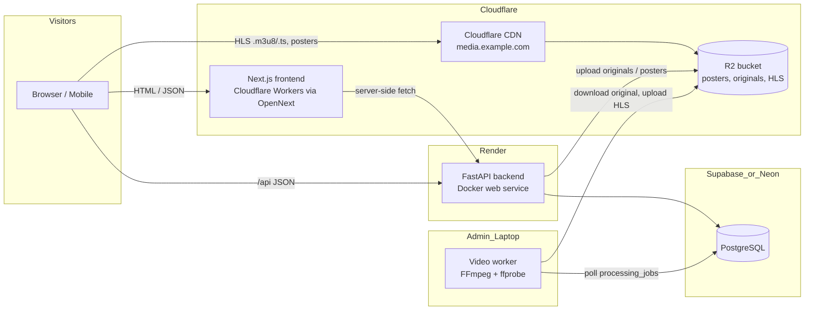
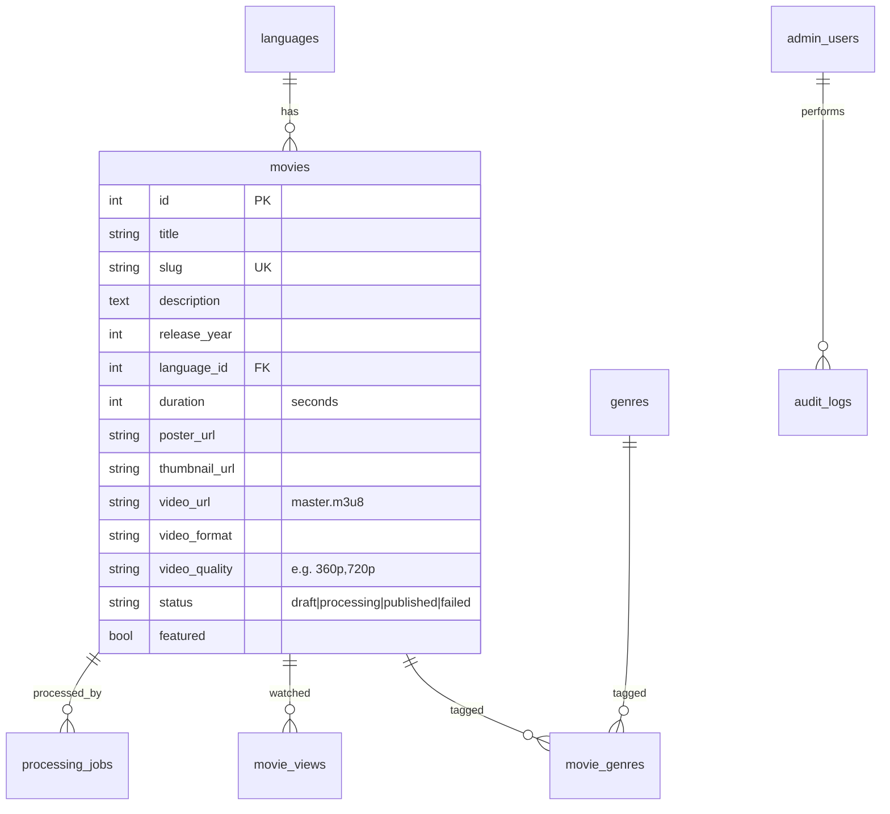

# Architecture — FreeReel

FreeReel is a legal, login-free movie streaming site. Visitors browse and watch
immediately; only administrators authenticate. Content is limited to public-domain
films, Creative-Commons films (e.g. Blender open movies) and titles we hold explicit
streaming rights for.

## 1. Final recommended architecture (MVP)

### Request flows

**Browse / search** — Browser → Next.js (server-rendered pages, cached 60 s) → FastAPI
public API → PostgreSQL. Movie pages are server-rendered so search engines can index them.

**Watch** — Movie page → `/watch/{slug}` → hls.js loads `master.m3u8` straight from
the CDN (R2 custom domain). The API is never in the video byte path, so streaming does
not consume backend CPU or bandwidth.

**Upload & processing** (never synchronous inside an HTTP request):

1. Admin uploads the original file from the dashboard → `POST /api/admin/movies/{id}/video`.
2. API streams the upload to disk with a size cap, checks magic bytes and extension,
   stores the original in object storage, inserts a `processing_jobs` row (`queued`),
   sets the movie to `processing` and returns `202 Accepted`.
3. The **worker** (`python -m app.workers.video_worker`) claims the job, runs `ffprobe`
   (duration, resolution, codecs), picks renditions ≤ source height from
   360p/480p/720p/1080p, runs FFmpeg to produce HLS playlists + segments and a thumbnail,
   uploads them, writes metadata, and publishes the movie (or marks it `failed` with the error).
4. The CDN serves the HLS output.

The worker is a separate process that only needs `DATABASE_URL` and storage credentials,
so it can run on the **admin's laptop** (free CPU), a cheap VM, or an AWS ECS/Batch
task later — no code change. For local development it can also run as a background
thread inside the API (`RUN_WORKER_IN_PROCESS=true`).

## 2. Technology stack and justification

| Layer | Choice | Why |
|---|---|---|
| Frontend | Next.js (App Router) + React + TypeScript + Tailwind CSS | SSR/SSG for SEO, dynamic metadata, `sitemap.ts`/`robots.ts` built in; Tailwind keeps the dark OTT UI consistent |
| Player | HTML5 `<video>` + hls.js (native HLS on Safari/iOS) | Free, small, adaptive bitrate, manual quality selection |
| Backend | Python 3.13, FastAPI, Pydantic v2, SQLAlchemy 2, Alembic | Typed, fast, automatic OpenAPI docs, mature migrations |
| Database | PostgreSQL (prod), SQLite (local/tests) | Same SQLAlchemy models on both; Postgres trigram/ILIKE search is enough for MVP |
| Auth (admin only) | Argon2id password hashing, short-lived JWT (HS256), role check | No public accounts; admin endpoints behind a dependency |
| Jobs | DB-backed job table + polling worker | No Redis/queue service to pay for; `SELECT … FOR UPDATE SKIP LOCKED` on Postgres |
| Video | FFmpeg + ffprobe → HLS (H.264/AAC, 6 s segments) | Universal device support |
| Storage | Storage interface with `local` and `s3` backends; R2 in prod | R2 has **zero egress fees** — decisive for video |
| CDN | Cloudflare (R2 custom domain) | Free, included with R2; CloudFront is the AWS-phase option |
| Hosting | Cloudflare Workers (frontend), Render (API), Supabase/Neon (Postgres) | All have no-card or free tiers; everything is a Docker image or standard Next build, so it moves to AWS unchanged |
| CI/CD | GitHub Actions | Free for public repos, generous minutes for private |

**Why not Vercel for the frontend?** Vercel's Hobby plan is for non-commercial use;
this site will carry ads, so Cloudflare (no such restriction on the free plan) is the safer choice.

## 3. Data model

Extra tables beyond the brief, each with a reason:

- `processing_jobs` — the job queue (status, attempts, error, timestamps).
- `site_events` — anonymous visit/page-view events with device category (needed for
  "total visits", "device category" and "traffic trends"). No IP address or raw
  User-Agent is stored; the session id is a random UUID generated in the browser.
- `movies.cast_members`, `movies.director` — "cast and crew if available".
- `advertisements.image_url`, `impressions`, `clicks` — needed for ad statistics.

`/api/categories` returns languages and genres together with movie counts. There is no
separate categories table because the brief's categories *are* languages and genres.

## 4. Security architecture

- Public API: read-only, no auth, rate limited per client IP (in memory; Redis later).
- Admin API: `/api/admin/*`, every route depends on `require_admin`. JWT expires in 60 min.
  Login is rate limited and constant-time (no user-enumeration timing difference).
- Uploads: extension allow-list + magic-byte sniffing, size caps, random server-side
  filenames (user filenames are never used for paths), ffprobe validation in the worker.
- FFmpeg is invoked with argument lists (no shell), with a timeout.
- Security headers middleware (CSP for the API, `X-Content-Type-Options`, `Referrer-Policy`,
  `X-Frame-Options`, HSTS in production). CORS restricted to configured origins.
- Secrets only from environment variables; `.env` is git-ignored; frontend only sees
  `NEXT_PUBLIC_*` values (API base URL, site URL).

See [security.md](security.md) for details.

## 5. Migration path to AWS

| MVP | AWS equivalent | Change needed |
|---|---|---|
| Render web service | ECS Fargate / App Runner / EC2 | Same Docker image |
| Supabase/Neon Postgres | RDS PostgreSQL | Change `DATABASE_URL` |
| R2 | S3 | `STORAGE_BACKEND=s3`, drop `S3_ENDPOINT_URL` |
| Cloudflare CDN | CloudFront | Change `MEDIA_PUBLIC_BASE_URL` |
| Laptop worker | ECS task / AWS Batch (Spot) | Same worker image, run on schedule or queue |
| Logs to stdout | CloudWatch Logs | Container log driver |

## 6. Cost risks (read before going live)

1. **Video bandwidth** is the dominant cost everywhere *except* R2. A 2-hour 720p film is
   ~2–3 GB; 1,000 full views is ~2.5 TB. That is why R2 is chosen.
2. **Storage grows with renditions.** Four renditions ≈ 1.8× the 1080p size. Store only
   renditions the source supports; delete originals after processing if needed (`KEEP_ORIGINALS=false`).
3. **R2 Class A operations**: every uploaded HLS segment is one write. A 2-hour film with
   4 renditions at 6 s segments ≈ 4,800 writes, comfortably inside 1M/month.
4. **Free compute sleeps.** Render free services spin down after 15 minutes idle (first
   request takes ~30–60 s). The frontend caches API responses to hide this.
5. **Free databases pause** after about a week idle (Supabase), and free databases have no backups.

Full numbers: [cost-estimation.md](cost-estimation.md).
